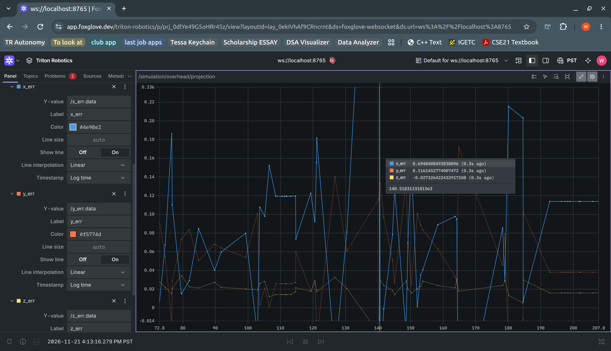

I couldn't run the simulation for long without my computer blowing up but some things I noticed were:

+ Z error was way less variable than x and y (because z is not changing).
+ There are sometimes big gaps between error datapoints which means huskybot isn't publishing new detections. I'm not sure why this happens.
+ Sometimes error will stay pretty steady and then vary a lot but it's hard to tell if the spikes line up with particular orientations of the panels.
+ When stopping the spin, error remains consistent because there's no physical jitter in the sim.
+ Error increases as I increase the distance between robots and decreases as I decrease the distance.
+ Error seems to always increase when a second panel is detected in frame. Error is lowest when a panel is centered and the enemy robot is broad-side to our robot.

I tried tripping the detection up by alternating between 100% clockwise and counter-clockwise spin but I was getting mixed results.

I did not experiment with movement much more than just moving further and closer because the robots in the simulation are slow and my laptop starts to overheat quickly when running the sim.

I was able to recreate the big spike with an x error of almost 0.7. I'm not sure what caused it, I think it was from switching from a slow spin speed to a fast speed but I wasn't able to recreate it again.
